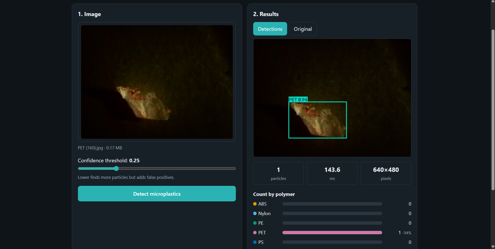
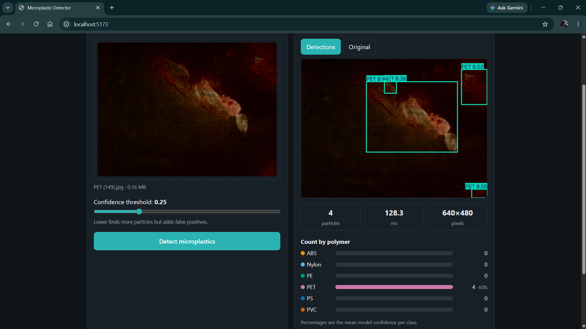
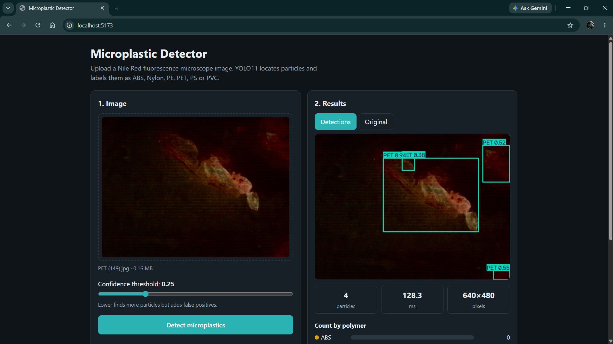

# Microplastic Detector

A web app that finds microplastic particles in **Nile Red fluorescence microscope images** and labels each one as **ABS, Nylon, PE, PET, PS or PVC**. Upload an image, get annotated detections, counts per polymer and downloadable results.





> **Demo video:** [Watch the 1-minute demo](https://youtu.be/h_AxL37-Iy4)

## What it does

- Detects particles with a **YOLO11** object-detection model trained on a public microscope dataset
- **FastAPI** backend: image upload, detection, counts and mean confidence per polymer, optional **MongoDB** history
- **React** frontend: drag-and-drop upload, confidence slider, annotated image, per-polymer bars, CSV/JSON export
- Reproducible pipeline: dataset preparation, training and evaluation scripts

```
dataset zips ─► training/prepare_dataset.py ─► training/train.py ─► models/best.pt
                                                                        │
                    React UI  ◄──── FastAPI (backend/main.py) ◄─────────┘
                                        └──► MongoDB (optional history)
```

## Results

Evaluated on a **held-out test set of 486 images** that the model never trained on and was not selected with. The split keeps whole capture sessions together, so near-identical frames cannot leak from training into testing (a random split would give inflated scores).

Model: YOLO11s, 640 px, 100 epochs, about 1 hour on an RTX 3050 laptop GPU.

| Class | Test images | Precision | Recall | mAP50 | mAP50-95 |
|---|---|---|---|---|---|
| **All** | 486 | 0.825 | 0.829 | **0.849** | **0.726** |
| ABS | 50 | 0.650 | 0.790 | 0.659 | 0.510 |
| Nylon | 100 | 0.855 | 0.904 | 0.947 | 0.828 |
| PE | 88 | 0.773 | 0.945 | 0.928 | 0.801 |
| PET | 90 | 0.906 | 0.470 | 0.666 | 0.525 |
| PS | 53 | 0.898 | 0.920 | 0.941 | 0.882 |
| PVC | 105 | 0.869 | 0.946 | 0.952 | 0.812 |

Full numbers: `results/test_metrics.json` (created by `training/evaluate.py`).

## Known limitations (please read)

- **ABS and PVC are confused with each other.** They look alike under this fluorescence imaging. On a test photo of PVC with 35 real particles, the app found 32 particles but labelled about half of them ABS. Finding and counting particles works well; naming the polymer is the weaker part.
- **PET is under-detected.** Only 47% of PET particles are found (precision is high at 0.91). PET also has the least training data (94 training images).
- **The mAP scores are generous.** They credit a correct label that appears among the model's guesses even when a different label has higher confidence, so the top label shown in the app can be less accurate than the table suggests.
- **PS test images share a capture session with its validation images**, so its score is less independent than the other classes.
- **Narrow scope.** The model has only seen Nile Red fluorescence images of six polymers from one lab's imaging setup. It is untested on other stains, microscopes, lighting, real environmental samples (water, sediment, tissue) or other polymers. Do not assume it generalises.
- **Screening, not confirmation.** Polymer identity from appearance should be confirmed with FTIR or Raman spectroscopy.

Ideas to improve: more varied data for ABS, PET and PVC, stronger lighting augmentation, a larger model (YOLO11m), and a test set from a different microscope.

## How AI was used to build this

I built this project with Claude as a pair programmer: planning the architecture, writing the training, backend and frontend code, and debugging on my own machine. I ran every step myself and checked the output against real results, for example:

- diagnosing a Windows crash during training (it stopped after I plugged in and switched to performance mode)
- noticing from the app that a PVC image was labelled half ABS, tracing it to a real weakness in the model, and finding that the same weakness appeared in the confusion matrix
- fixing duplicate overlapping boxes by keeping one label per particle (`agnostic_nms`)
- choosing a session-based data split to avoid inflated scores

## Run it yourself

Needs Python 3.11, Node 18+ and Git. An NVIDIA GPU is strongly recommended for training (inference works on CPU).

**1. Get the dataset** (not included; see licence below)

```powershell
git clone https://github.com/sombsuk/dataset_microplastic.git ..\dataset_microplastic_raw
```

**2. Python environment.** Install PyTorch with CUDA **first** (command from https://pytorch.org/get-started/locally/), then:

```powershell
py -3.11 -m venv venv
.\venv\Scripts\Activate.ps1
pip install -r requirements.txt
python -c "import torch; print(torch.cuda.is_available())"
```

**3. Prepare the data**

```powershell
python training\prepare_dataset.py --repo ..\dataset_microplastic_raw --out dataset
```

**4. Train and evaluate** (keep a laptop plugged in and in high-performance mode; my laptop crashed once when training on battery)

```powershell
python training\train.py --model yolo11s.pt --epochs 100 --batch 8 --workers 2
python training\evaluate.py
```

Or skip training: download `best.pt` from the [Releases](../../releases) page and place it in `models/`.

**5. Run the app**

```powershell
uvicorn backend.main:app --port 8000        # terminal 1, project root
cd frontend; npm install; npm run dev       # terminal 2 -> http://localhost:5173
```

Check http://127.0.0.1:8000/api/health for `"model_loaded": true`.

Optional history: `docker run -d -p 27017:27017 mongo:7`, then set `$env:MONGO_URL = "mongodb://localhost:27017"` before starting the backend.

**API:** `POST /api/detect` (multipart: `file`, optional `conf`, `iou`), `GET /api/health`, `GET /api/history`.

## Credits and licence

- **Dataset:** Rermborirak, K., Nanuan, P., Komonpan, P., & Sukpancharoen, S. (2025). *Low-cost portable microplastic detection system integrating nile red fluorescence staining with YOLOv8-based deep learning.* Journal of Hazardous Materials Advances, 19, 100787. https://doi.org/10.1016/j.hazadv.2025.100787 · [dataset repo](https://github.com/sombsuk/dataset_microplastic). Licensed **CC BY-NC-ND 4.0**: non-commercial use only; it is **not** redistributed in this repository.
- **Model framework:** built with [Ultralytics YOLO11](https://github.com/ultralytics/ultralytics) (AGPL-3.0).
- This is a research and portfolio prototype, not a validated measurement tool.
